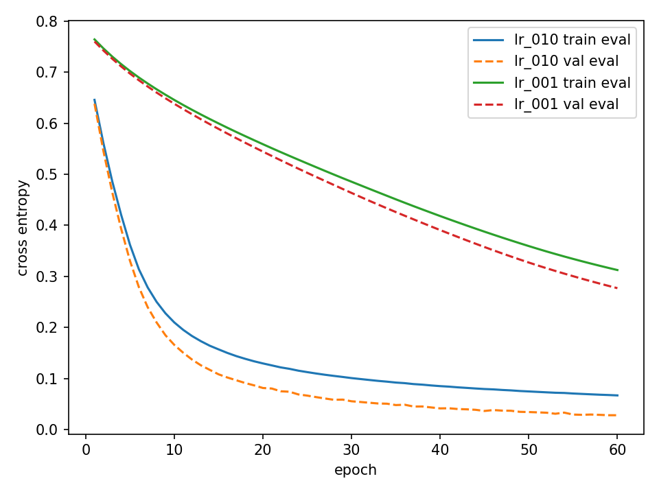

# 第 7 周 · 学习率对照与二分类评测

**实验问题**：用相同的数据、相同的初始模型和相同的训练预算，只把 SGD 的学习率从 0.01 改成 0.1，模型学得有多快，最后会错在哪些点上？

这次实验中，学习率 0.1 在第 10 轮已分对全部 40 个验证样本，到第 60 轮仍为 40/40。学习率 0.01 在第 10 轮分对 20/40，到第 60 轮达到 39/40，唯一漏掉的是 `s171`。下文的数值来自本目录保存的预测与训练历史。

## 1. 数据、模型和公平对照

沿用第 6 周的 [samples.csv](data/samples.csv)。每行是一个二维坐标，列为 `sample_id, x1, x2, label, split`。标签规则是 `x1 + x2 > 0` 时取 1，其余取 0。共 200 个点，固定训练集 160 条、验证集 40 条，两个类别在各自集合中均等。训练集用于更新参数，验证集用于检查模型在留出样本上的表现。

| 本周的实验设置 | 两组如何处理 |
|---|---|
| 学习率 `lr` | 唯一主动改变的量。`lr_010` 是 0.1，`lr_001` 是 0.01。SGD 每一步沿梯度反方向更新参数，学习率决定更新幅度。 |
| 数据与顺序 | 两组读同一个 CSV，按已有 `split` 选行。对原始文件字节算 SHA-256 并写入配置，可用来检查输入是否相同。训练时打乱顺序，给两组的数据加载器各自设置相同种子 43。 |
| 模型与起点 | 每组开始时重设模型种子 44，重新创建模型、优化器和加载器。两组训练前的验证损失均为 0.779660。这样第二组从同一起点开始。 |
| 训练预算 | CPU，SGD，交叉熵损失，60 个 epoch，每批 16 条。一个 epoch 遍历训练集一次，即每轮 10 批、每组 600 次参数更新。 |

## 2. 一批数据怎样变成一个预测

1. `ToyDataset` 从 CSV 取出对应划分，把两个坐标转为 `float32`、标签转为 `long`。`__len__` 给出样本数，`__getitem__` 按索引返回一个 `(特征, 标签)`。`DataLoader` 把它们组成批次。一个满批的输入形状是 `[16, 2]`，标签形状是 `[16]`。
2. `SmallMLP` 依次经过 `Linear(2, 8)`、`ReLU`、`Linear(8, 2)`。每个样本输出两个原始类别分数（logits）。`CrossEntropyLoss` 直接接收 logits 和真实类别索引；`argmax(dim=1)` 选每行分数最大的类别作为预测。
3. 训练时调用 `model.train()`。每批先用 `zero_grad()` 清理上一批梯度，再前向计算损失，调用 `backward()` 求梯度、`step()` 更新参数。求整轮平均损失时，用每批损失乘以该批样本数，累加后除以总样本数。
4. 评估时使用 `model.eval()` 和 `torch.no_grad()`，保持参数固定。验证加载器按原顺序读取，导出时可以把预测与样本 ID 一一对应。

## 3. 怎样读训练历史和曲线

| `history.csv` 字段 | 含义 |
|---|---|
| `epoch` | 已完成的训练轮数。 |
| `online_loss` | 训练过程中各批损失的加权平均。各批计算时的模型参数随更新而变化。 |
| `train_loss` | 每轮训练结束后，用该轮最终参数重新评估完整训练集得到的平均损失。 |
| `val_loss`、`val_acc` | 用同一轮最终参数评估验证集得到的平均交叉熵、预测正确比例。 |



图中横轴是训练轮数，纵轴是交叉熵。同一学习率的实线是 `train_loss`，虚线是 `val_loss`，两条线衡量的是同一时刻的模型。可以从两个角度读：

- **学习速度**：从第 1 轮到第 10 轮，0.1 组验证损失从 0.6381 降到 0.1657；0.01 组从 0.7601 降到 0.6381。在本次运行的前 10 轮，0.1 组下降更快。
- **损失和准确率提供不同信息**：0.1 组第 10 轮和第 60 轮准确率都是 100%，验证损失仍从 0.1657 降到 0.02785。预测类别可以保持相同，同时模型给真实类别的概率整体提高。判断过拟合时要看多轮趋势，例如训练损失持续下降、验证损失持续上升；单轮两条线有距离还不足以判断。

## 4. 从逐条预测算出四个指标

把标签 1 当作正类。真实 1、预测 1 计为 **TP**；真实 0、预测 1 计为 **FP（误报）**；真实 0、预测 0 计为 **TN**；真实 1、预测 0 计为 **FN（漏报）**。

| 指标 | 公式 | 回答的问题 |
|---|---|---|
| Precision（精确率） | TP / (TP + FP) | 被预测为正的样本中，有多少确实为正？ |
| Recall（召回率） | TP / (TP + FN) | 所有真实正样本中，有多少被找到了？ |
| F1 | 2TP / (2TP + FP + FN) | 精确率和召回率的调和平均是多少？ |
| Accuracy（准确率） | (TP + TN) / 总数 | 所有样本中，有多少分对了？ |

`metrics.py` 检查输入长度、空列表和二分类标签。单项指标的分母为零时，本练习约定记为 0.0；样本总数为零时停止评测。`analyze_results.py` 检查预测 ID 是否唯一、是否覆盖整个验证集，并按 ID 核对真实标签。最后用混淆矩阵复算准确率，与最后一轮的 `val_acc` 比较，允许小于 `1e-9` 的浮点误差。

| 学习率 | TP | FP | TN | FN | Precision | Recall | F1 | Accuracy | 第 60 轮验证损失 |
|---|---:|---:|---:|---:|---:|---:|---:|---:|---:|
| 0.1 | 20 | 0 | 20 | 0 | 1.0000 | 1.0000 | 1.0000 | 1.0000 | 0.02785 |
| 0.01 | 19 | 0 | 20 | 1 | 1.0000 | 0.9500 | 0.9744 | 0.9750 | 0.27683 |

**手算与错误回查**：0.01 组预测为正的 19 个点都分对了，所以精确率为 19/19。真实正类共 20 个，所以召回率为 19/20；F1 为 38/39，准确率为 (19+20)/40。逐条预测显示漏报的是 `s171`，其坐标约为 `(0.75, -0.70)`，和约为 0.05，位于真实边界 `x1+x2=0` 的正侧。它靠近边界是可核查的观察，训练轮数是否造成这次误判还需单独实验。

**当前导出细节**：[errors.csv](output/errors.csv) 已写出 `s171` 的真实标签、预测标签和 `FN`。表头包含 `run, x1, x2`，生成错误记录的字典尚未填入这三项，因此 CSV 中为空。上面的组名和坐标分别来自对应组的预测文件和原始样本表。

## 5. 文件与独立重跑

| 文件 | 用途 |
|---|---|
| [dataset.py](dataset.py)、[model.py](model.py) | 按划分装载数据、定义分类网络。 |
| [train_classifier.py](train_classifier.py) | 提供单轮训练和评估函数，供本周实验入口复用。 |
| [run_experiments.py](run_experiments.py) | `run_one` 分别训练两组，`save_run` 写出配置、逐轮历史和最后一轮的逐样本预测。 |
| [metrics.py](metrics.py)、[analyze_results.py](analyze_results.py) | 计数和计算指标，检查预测，再生成 [comparison.csv](output/comparison.csv) 和错误表。 |
| [plot_comparison.py](plot_comparison.py) | 读取两份历史，以 Matplotlib 绘制并保存四条损失曲线。 |

本次环境为 Python 3.9.13、PyTorch 2.8.0 CPU，绘图用 Matplotlib。以下 PowerShell 命令从 `week_07_todo` 的上一级运行；将 `$py` 换成自己安装了这两个库的解释器路径即可。

```powershell
$py = 'E:\anacanda\python.exe'
& $py .\week_07_todo\run_experiments.py
& $py .\week_07_todo\analyze_results.py
& $py .\week_07_todo\plot_comparison.py
```

脚本通过 `Path(__file__).resolve().parent` 定位数据和输出。每组的 `output/lr_010/` 或 `output/lr_001/` 应有一份 `config.json`、60 行历史和 40 行预测（均按数据行计）。分析脚本可单独重跑；绘图脚本通过 `savefig` 保存 PNG，终端可以没有输出。重跑会更新对应的结果文件。

## 6. 论文、算法与下一步

- **论文阅读方法**：按“研究对象 → 输入 → Agent 与工具分别做什么 → 输出证据 → 如何评价”整理论文。比较两篇工作时，记下数据划分、统计单位、指标分母、工具证据、成本、局限及原文页码。例如，只知道人工审查了多少条候选告警，还需要真实漏洞总数才能计算召回率。
- **算法练习方法**：按独立算法周次安排 4 次、每次 45 分钟。若处在集合与字典专题，可练集合判重、字典计数或查找，写明时间与空间复杂度，隔天独立复做，并练一次完整输入输出。具体论文与已完成题号按个人实际记录补充。
- **实验局限**：数据由简单坐标规则生成，只有一次固定划分和一套随机种子。40 条验证样本中一个样本就对应 2.5 个百分点。本次结果支持在这份数据和 60 轮预算下比较两种学习率；若要判断结论是否稳定，可在多个种子下重复对照。
- **第 8 周衔接**：用 `state_dict` 保存训练后的模型，在新进程中重建相同网络、加载权重，检查相同输入的预测是否一致。
